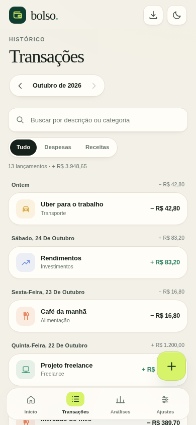
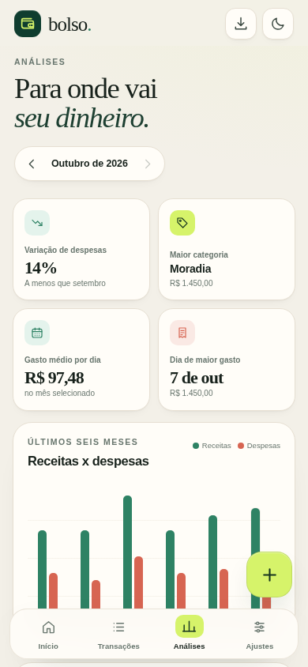
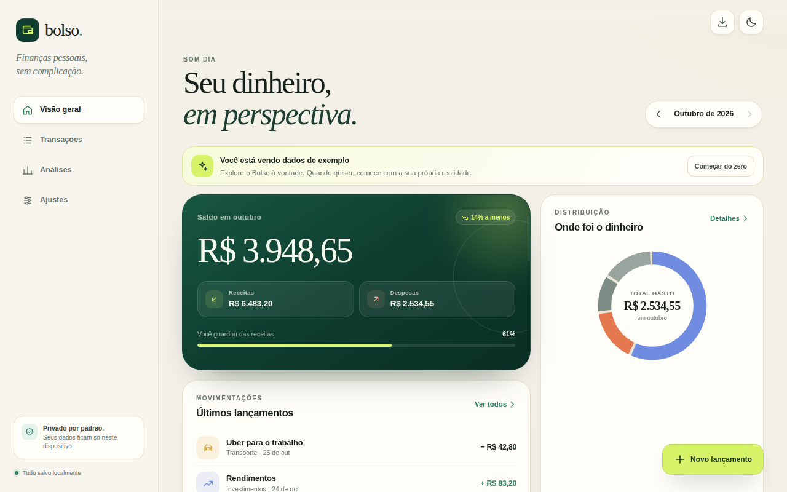

# Bolso

**Finanças pessoais, sem complicação.**

O Bolso é uma PWA de controle financeiro pessoal, feita para o celular. Registre receitas e despesas, acompanhe o saldo do mês, entenda para onde o dinheiro vai e mantenha tudo isso **somente no seu dispositivo**.

Sem cadastro, sem anúncios, sem servidor e sem enviar dados para lugar nenhum.

<p align="center">
  
  
  
</p>

<p align="center">
  
</p>

## Recursos

- **Visão geral do mês:** saldo, receitas, despesas, taxa de poupança e distribuição dos gastos por categoria.
- **Transações completas:** criar, editar, excluir com desfazer, buscar por descrição ou categoria e filtrar por tipo.
- **Análises:** comparativo com o mês anterior, maior categoria, gasto médio diário, dia de maior gasto, gráfico de seis meses e detalhamento por categoria.
- **Ajustes:** tema claro, escuro ou do sistema, exportação em CSV, instalação do app e limpeza dos dados.
- **Dados de exemplo:** na primeira visita, o app abre com um mês demonstrativo que pode ser apagado ou recarregado.
- **PWA instalável:** manifest, ícones, atalhos, service worker, funcionamento offline e tela de atualização.
- **Interface responsiva:** navegação inferior no celular, barra lateral no desktop e formulário em bottom sheet.
- **Acessibilidade:** navegação por teclado, foco controlado nos diálogos, rótulos ARIA, contraste e respeito a `prefers-reduced-motion`.

## Privacidade

O Bolso não tem backend. Todas as transações e preferências ficam no `localStorage` do navegador:

- nada é enviado para a internet;
- não há analytics, cookies de rastreamento ou login;
- limpar os dados do site remove os lançamentos;
- o CSV é gerado localmente no dispositivo.

Como o armazenamento é local, os dados não são sincronizados entre aparelhos. Use a exportação em CSV para guardar uma cópia.

## Tecnologia

- HTML, CSS e JavaScript puro, com módulos ES;
- sem etapa de build e sem dependências de produção;
- `manifest.json` + `sw.js` para instalação e cache offline;
- `localStorage` como única persistência;
- deploy estático no [Render](https://render.com/).

## Rodar localmente

O service worker exige um servidor HTTP. Na raiz do projeto:

```bash
python3 -m http.server 4173 --directory public
```

Abra [http://localhost:4173](http://localhost:4173).

Também funciona com qualquer servidor estático, por exemplo:

```bash
npx serve public
```

## Estrutura

```text
.
├── public/
│   ├── index.html          # app shell e todas as telas
│   ├── manifest.json       # manifesto da PWA
│   ├── sw.js               # cache offline e atualização
│   ├── css/styles.css      # estilos responsivos e temas
│   ├── js/
│   │   ├── app.js          # interface, estado e eventos
│   │   ├── store.js        # dados, cálculos e categorias
│   │   └── theme.js        # tema aplicado antes da primeira pintura
│   ├── icons/              # ícones da PWA e favicons
│   └── screenshots/        # imagens do manifesto e documentação
├── design/
│   └── icon-source.svg     # fonte vetorial dos ícones
├── render.yaml             # Blueprint do Render
└── README.md
```

## Deploy no Render

O projeto é publicado como **Static Site**, sem build, a partir da pasta `public/`.

### Com Blueprint (recomendado)

1. Envie o repositório para o GitHub.
2. No painel do Render, escolha **New → Blueprint**.
3. Conecte o repositório. O Render encontra o `render.yaml` automaticamente.
4. Confirme a criação do serviço `bolso`.
5. Aguarde o deploy. O endereço ficará no formato `https://bolso.onrender.com`.

O Blueprint já configura o diretório de publicação, os cabeçalhos de segurança e `Cache-Control: no-cache` para que o service worker encontre sempre a versão mais recente.

### Manualmente

1. **New → Static Site** e conecte o repositório.
2. Deixe o **Build Command** vazio.
3. Defina **Publish Directory** como `public`.
4. Crie o site e aguarde o primeiro deploy.

## Atualizações do PWA

O `sw.js` guarda o app shell em cache. Ao alterar arquivos publicados, incremente `VERSION` no topo de `public/sw.js`:

```js
const VERSION = "1.0.1";
```

Assim, o navegador detecta o novo service worker, mostra o aviso **“Nova versão disponível”** e atualiza o app quando o usuário toca em **Atualizar**.

## Instalação no celular

- **Android / Chrome / Edge:** use o ícone de instalação na barra superior ou o menu do navegador → **Instalar aplicativo**.
- **iPhone / iPad:** abra no Safari → **Compartilhar** → **Adicionar à Tela de Início**.

Depois da primeira visita, o Bolso abre sem conexão e mantém os lançamentos salvos no aparelho.

## Licença

Este projeto está disponível sob a licença [MIT](LICENSE).
